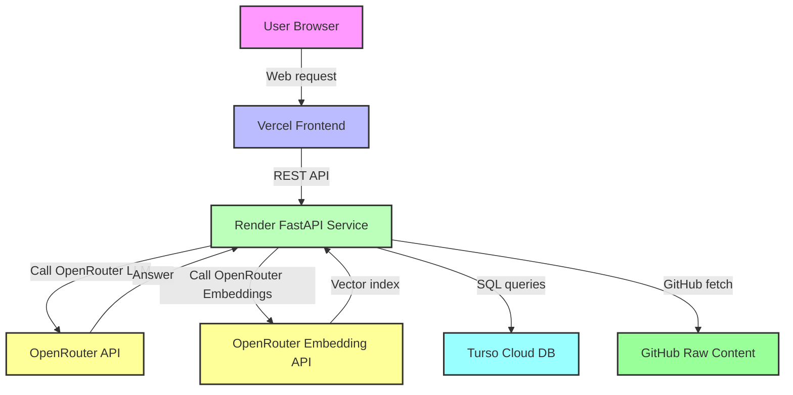
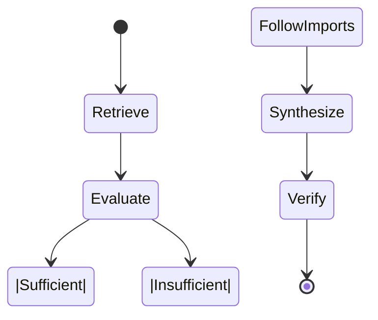

# RepoAsk – Ask Any Public GitHub Repository

## Overview
RepoAsk lets a user paste any public GitHub URL and ask natural‑language questions about the code. The system returns concise answers based on the repository’s source files, documentation and project structure.

## Why This Architecture?
- **OpenRouter only** – No paid API keys. Free models are used for LLM and embeddings.
- **FastAPI + LangGraph** – Provides a clear state‑machine for retrieval, synthesis and verification.
- **Hybrid search** – Combines vector similarity (cloud embeddings) with BM25 keyword search for reliable results.
- **Dual‑track retrieval** – Separates local code queries from global catalog queries to avoid the “global query problem”.
- **Render (backend) + Vercel (frontend)** – Free tier services that support HTTPS and automatic scaling.
- **Turso Cloud SQLite** – Server‑less relational store with low latency and zero maintenance.

## Architecture Flow


## AI Pipeline (LangGraph)

- **Retrieve** – Uses dual‑track engine to fetch relevant chunks.
- **Evaluate** – Checks if the result set covers the user intent.
- **FollowImports** – Expands search to imported files when needed.
- **Synthesize** – Calls the LLM to draft an answer.
- **Verify** – Re‑asks the model to confirm factual consistency.

## Challenges Faced
| # | Challenge | Resolution |
|---|-----------|------------|
| 1 | Global query problem – RAG could not answer “list all routes”. | Added dual‑track retrieval that runs a file‑tree scan for catalog queries. |
| 2 | 512 MB RAM limit on Render free tier. | Moved embeddings to OpenRouter cloud API; kept only lightweight FastEmbed as fallback. |
| 3 | SSE stream closed by Render proxy after idle time. | Implemented heartbeat `: ping` every 2.5 s and disabled buffering. |
| 4 | UI flicker when typing questions. | Isolated `QuestionBar` component and switched layout to Flexbox. |

## Future Improvements
- **HyDE (Hypothetical Document Embeddings)** to turn a question into a synthetic document before retrieval.
- **AST‑aware chunking** using Tree‑Sitter for more precise code sections.
- **Corrective RAG (CRAG)** – Self‑reflection loop to repair inaccurate answers.
- **In‑app code viewer** that shows the selected snippet alongside the answer.
- **Call‑graph storage** in Turso for automated impact analysis.

## Tech Stack
| Layer | Technology |
|-------|------------|
| Frontend | React 18, Vite, Tailwind CSS, Mermaid |
| Backend | FastAPI, LangGraph, LangChain‑OpenAI (OpenRouter), rank_bm25 |
| Embeddings | OpenRouter Cloud Embeddings (primary), FastEmbed ONNX (fallback) |
| Database | Turso Cloud (LibSQL) |
| Deployment | Render (backend), Vercel (frontend), GitHub Actions keep‑alive |
| LLM | OpenRouter free models (e.g., Nemotron‑340B) |

## Quick Start (Local Development)
```bash
# Clone repository
git clone https://github.com/yourname/RepoAsk.git
cd RepoAsk

# Backend setup (Windows PowerShell)
python -m venv .venv
.\.venv\Scripts\Activate.ps1
pip install -r backend/requirements.txt
# Create .env with OpenRouter key and Turso URL (do NOT commit)

# Run backend
uvicorn backend/app/main:app --reload

# Frontend setup
cd frontend
pnpm install
pnpm run dev
```
> **Note:** Do not commit the `.env` file. It contains secret keys.

## Documentation
Full documentation resides in the `docs/` folder.
- **[Architecture Details](docs/README.md)** – Overview of components.
- **[Challenges – Global Query Dual Track](docs/12-challenges-global-query-dual-track.md)** – In‑depth explanation.
- **[Deployment Guide](docs/11-deployment-guide.md)** – Render, Vercel and Turso setup.
- Additional design notes are listed in `docs/` index.

## Contributing
Please follow the contribution guide in `docs/`. Open pull requests against `main`. Ensure that all tests pass and that the README remains up‑to‑date.

---
*RepoAsk is ready to be pushed to GitHub.*