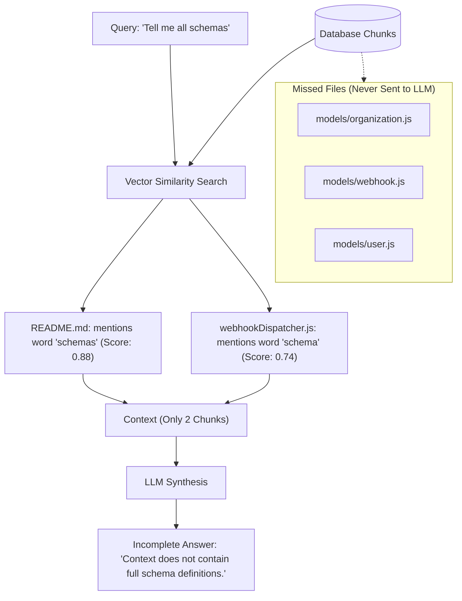
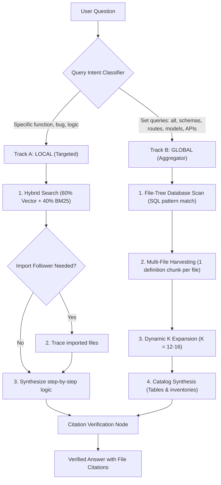

# Engineering Challenges: The Global Query Problem and Dual-Track Solution

This document describes a primary engineering challenge in repository question-answering systems: **The Global Query Problem**. It defines the problem, explains the root cause, and specifies the **Dual-Track Retrieval Architecture** used as the solution.

---

## 1. The Problem: Global Query Failure in Code Retrieval

### 1.1 Context
RepoAsk uses Retrieval-Augmented Generation (RAG). The system converts user questions into vector numbers and finds the most similar code chunks in the database.

### 1.2 Observed Failure
A user entered the query:
> *"Tell me all schemas in the repository"*

The system gave this answer:
> *"The retrieved context does not contain the full schema definitions. It only mentions that the project uses nested MongoDB document schemas and Zod validation schemas. Schemas are likely defined in backend model files not included in the retrieved context."*

The answer was truthful, but incomplete. The repository contained multiple schema files (`models/organization.js`, `models/webhook.js`, `models/user.js`). The search engine failed to retrieve them.



---

## 2. Root Cause Analysis

Three distinct technical conditions cause this defect:

### 2.1 Point-Lookup vs. Set-Aggregation Mismatch
* Vector similarity finds the nearest single text chunk to a question.
* Specific queries (*"How does webhook verification work?"*) need a single chunk (**Point-Lookup**). Vector search performs well here.
* Collection queries (*"List all schemas"*, *"List all routes"*) need an exhaustive set of items (**Set-Aggregation**). Vector search cannot gather distributed sets across different files.

### 2.2 Semantic Granularity Gap
* The file `models/user.js` contains fields: `email`, `passwordHash`, `createdAt`. It does not contain the general phrase: *"This is a schema in the repository"*.
* The file `README.md` contains the exact words: *"MongoDB schemas and Zod validation"*.
* The search algorithm scored `README.md` higher than the actual code files.

### 2.3 Fixed Window Limit ($K = 4$)
The retrieval node was fixed to return a maximum of 4 chunks. If a repository has 10 schemas across 10 files, a search with $K=4$ cannot deliver the complete set.

---

## 3. The Solution: Dual-Track Retrieval Engine

To solve this problem, RepoAsk separates query processing into two distinct operational modes: **Track A (Local)** and **Track B (Global)**.



---

## 4. Track Specifications

### 4.1 Track A: Local Query Engine
* **Purpose**: Answer questions about specific functions, files, bugs, or data flows.
* **Input Triggers**: Specific function names, identifiers, or feature questions without aggregate words.
* **Process**:
  1. Generate query vector using OpenRouter embedding model.
  2. Execute hybrid search: $0.60 \times \text{Cosine Similarity} + 0.40 \times \text{BM25 Score}$.
  3. Set chunk limit: $K = 5$.
  4. Run LangGraph `evaluate_retrieval_adequacy` conditional edge. If the code imports helper modules, follow the import link to collect the second file.
* **Output Format**: Technical explanation with sequential steps and code line citations.

### 4.2 Track B: Global Query Engine
* **Purpose**: Enumerate complete sets of components across the repository.
* **Input Triggers**: Keywords: `all`, `every`, `list`, `schemas`, `models`, `routes`, `endpoints`, `tables`, `architecture`.
* **Process**:
  1. Detect the target domain category:
     * **Schemas & Models**: Match paths containing `model`, `schema`, `entity`, `entities`, `types`, `dto`.
     * **Routes & Endpoints**: Match paths containing `route`, `routes`, `controller`, `controllers`, `api`.
     * **Architecture & Stack**: Match `README.md`, `package.json`, `pyproject.toml`, `go.mod`.
  2. Execute file-tree lookup in the database:
     ```sql
     SELECT id, path FROM files 
     WHERE repo_id = ? 
       AND (path LIKE '%model%' OR path LIKE '%schema%' OR path LIKE '%entity%')
     ```
  3. Retrieve definition chunks from **each matching file** instead of multiple chunks from one file.
  4. Dynamically expand context window to $K = 12 \text{ to } 16$ chunks.
  5. Apply catalog synthesis prompt instructing the model to list all items systematically.
* **Output Format**: Structured inventory table or checklist with direct links to each file.

---

## 5. Ingestion Defense: File Priority Protection

In `backend/app/ingest.py`, files that represent schemas, models, and routes must never be dropped when a repository exceeds the chunk budget.

The priority filter rules:
1. **Always Retain (Priority 1)**: `README.md`, documentation files.
2. **Always Retain (Priority 2)**: Entry points (`main.py`, `app.py`, `index.js`, `server.js`).
3. **Always Retain (Priority 3)**: Schema and model directories (`models/*`, `schemas/*`, `entities/*`, `types/*`).
4. **Always Retain (Priority 4)**: Route directories (`routes/*`, `controllers/*`, `api/*`).
5. **Round-Robin Remaining**: All remaining utility, helper, and test files.

---

## 6. Verification and Acceptance Criteria

| Test Case | Query | Expected Track | Expected Output |
|---|---|---|---|
| TC-01 | *"How does verifySignature work?"* | Track A (Local) | Step-by-step logic of `verifySignature` with lines from `webhookDispatcher.js`. |
| TC-02 | *"Tell me all schemas in this repo"* | Track B (Global) | Table enumerating `Organization`, `Webhook`, `User` with field details and line citations. |
| TC-03 | *"List all API endpoints"* | Track B (Global) | Table listing HTTP methods (`GET`, `POST`), URL paths, and matching controller files. |
| TC-04 | *"What is the main architecture?"* | Track B (Global) | High-level system overview combining root README and configuration files. |

